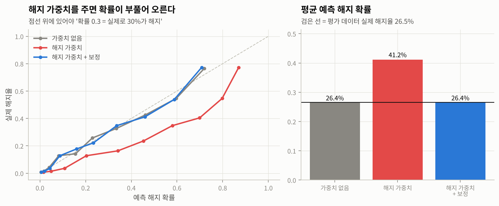
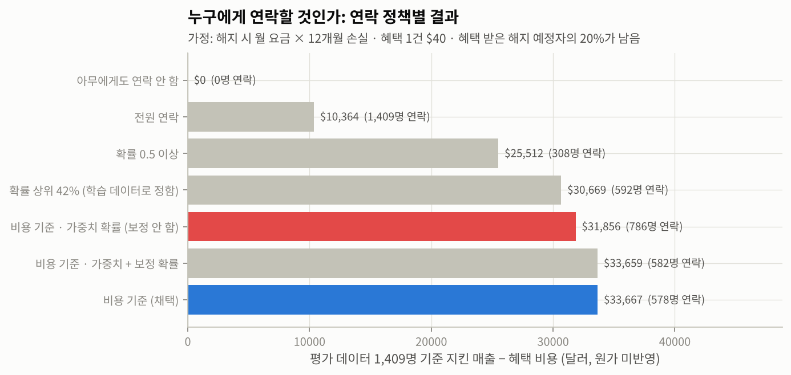
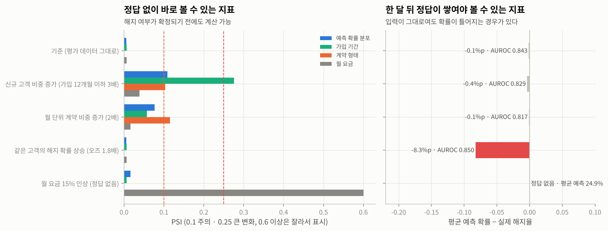
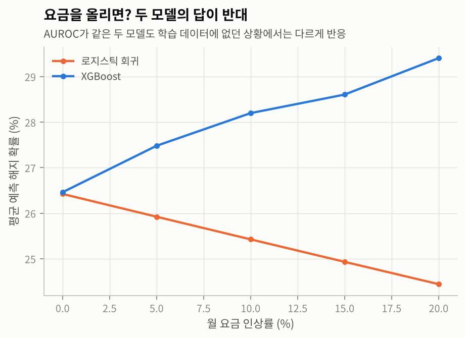

# 통신사 고객 해지 예측과 방어 대상 선정 (Telco Churn Retention)

통신사 고객 7,043명의 가입 정보로 **누가 해지할지 예측하고, 그 확률로 누구에게 해지 방어 혜택을 줄지 정한** 프로젝트입니다.

## 한 장 요약

기본 가정: 해지하면 월 요금 12개월치를 잃고, 혜택(쿠폰) 1건은 $40이며, **혜택을 받은 해지 예정 고객 중 20%가 해지를 취소하고 남는다**고 봤습니다. 이 '남는 비율'과 혜택 비용은 데이터에 없는 값이라 가정입니다.

**사업 담당자에게 드릴 결론**

1. **연락 대상은 해지 확률만 보지 않고 '해지 확률 × 그 고객을 지키면 남는 매출'로 고릅니다.** 이렇게 고른 578명과, 해지 확률이 높은 순서대로 고른 578명을 비교하면 후자가 해지자를 5명 더 잡지만 지키는 매출은 $2,715 적습니다. 학습 데이터로 정한 '해지 확률 상위 42%에 연락' 방식보다도 $2,998 더 남습니다.
2. **혜택 종류가 바뀌면 고르는 기준도 바꿔야 합니다.** 정액 쿠폰이면 요금이 높은 고객부터 연락합니다. '1개월 요금 할인'처럼 요금에 비례하는 혜택이면 요금과 상관없이 해지 확률이 41.7%를 넘는 고객 전원에게 연락하는 게 맞고, 정액 쿠폰 기준을 그대로 쓰면 31% 손해입니다.
3. **해지 고객이 적다고 학습할 때 해지 고객에 가중치를 주면, 예측 확률이 실제보다 부풀어 연락할 사람이 늘어납니다** (평균 예측 26% → 41%, 실제 해지율 26.5%). 연락 판단에는 실제 해지율과 맞는 확률을 써야 합니다.
4. **남는 비율 20%는 실험으로 재야 합니다.** 연락 대상자를 무작위로 나눠 일부에게는 혜택을 주지 않고 해지율을 비교합니다. 통화가 연결된 1,207명으로 실험하고 그중 20%를 비교용으로 남기면 혜택에 효과가 있는지는 알 수 있지만, 남는 비율은 20% ± 12%p 범위로만 알 수 있습니다. ±5%p로 재려면 약 5,000명이 필요합니다.
5. **운영 중에는 매달 '평균 예측 해지 확률'과 '실제 해지율'이 맞는지 봅니다.** 모든 고객의 해지 위험이 함께 오르면 누가 더 위험한지 순서는 그대로라, 순서를 보는 지표(AUROC)로는 이 변화를 알아챌 수 없습니다.

| 결과물 | 내용 |
|---|---|
| 모델 | 로지스틱 회귀 (교차검증 AUROC 0.845, XGBoost 0.844가 낫다고 할 근거 없음). 요금 4개 구간 모두 예측과 실제 해지율 차이 2%p 이내 |
| 연락 대상 리스트 | [`sql/call_list.sql`](sql/call_list.sql)로 뽑은 578명. 우선순위, 해지 확률, 기대값, 고객별 연락 사유 2개, 상담 포인트 ([`call_list.csv`](reports/tables/call_list.csv)) |
| 가정 민감도 | 혜택 비용 4단계 × 남는 비율 5단계 = 20가지 중 18가지에서 '확률 상위 k%' 방식보다 나음 |
| 실험 설계 | 남는 비율을 재는 데 필요한 대상자 수와 대조군 비용 |
| 모니터링 | 고객 구성 변화, 해지 위험 상승, 요금 인상 시나리오별로 어떤 지표가 먼저 반응하는지 |

> 데이터: [IBM Telco Customer Churn](https://github.com/IBM/telco-customer-churn-on-icp4d) (Apache 2.0) · Python, SQLite, scikit-learn, XGBoost
> 금액은 데이터 단위인 달러입니다. 혜택 비용과 효과는 데이터에 없는 값이라 모두 가정이고, 원가(망 도매대가 등)는 빼지 않은 매출 기준입니다.
> 공개 데이터라 국내 해지 방어의 핵심 변수인 약정 만료 시점, 단말 할부 잔여, 결합 상품 정보가 없고, 시점 정보도 없습니다 (10절).

<details>
<summary><b>용어 풀이</b> (처음 보는 용어가 있다면)</summary>

| 용어 | 뜻 |
|---|---|
| AUROC | 해지할 고객을 안 할 고객보다 위에 세우는 '순서'가 얼마나 맞는지. 0.5는 무작위, 1은 완벽 |
| 보정(캘리브레이션) | 예측 확률이 실제 비율과 맞는지. '30%'라고 예측한 고객 중 실제로 30% 정도가 해지하면 잘 맞는 것 |
| 기대값 | 해지 확률 × 남는 비율 × 지킬 수 있는 매출 − 혜택 비용. 0보다 크면 연락하는 게 이득 |
| %p | 퍼센트끼리의 차이. 26%와 34%의 차이는 8%p |
| 95% 신뢰구간 | 데이터를 다시 뽑아도 결과가 대부분 이 범위 안에 든다는 뜻. 0을 포함하면 차이가 있다고 말하기 어려움 |
| 교차검증 | 학습 데이터를 5조각으로 나눠 돌아가며 평가해 운에 따른 성능 차이를 줄이는 방법 |
| PSI | 지금 고객 분포가 학습할 때와 얼마나 달라졌는지. 0.1 이상 주의, 0.25 이상 큰 변화 |
| 누수 | 예측 시점에는 알 수 없는 정보가 학습에 섞여 성능이 부풀려지는 문제 |
| 대조군 | 비교를 위해 일부러 혜택을 주지 않는 고객 집단 |
| 오즈 | 해지 확률 ÷ 해지하지 않을 확률. 확률을 비율로 올리고 내릴 때 쓰는 단위 |
| 업리프트 모델 | '해지할 고객'이 아니라 '혜택을 주면 마음을 바꿀 고객'을 찾는 모델 |

</details>

```
SQLite 적재·SQL 피처 → 누수 점검 → 모델 비교 → 확률 보정 → 비용 기준 연락 대상 → 연락 리스트 → 가정 민감도 → 실험 설계 → 운영 모니터링
```

---

## 1. 문제 정의

해지 방어는 해지할 것 같은 고객에게 할인이나 혜택을 주는 일입니다. 여기서 실제로 필요한 판단은 "이 사람이 해지할까"가 아니라 **"이 사람에게 혜택을 주면 남는 게 있을까"** 입니다.

- 해지하지 않을 고객에게 혜택을 주면 혜택 비용만 나갑니다.
- 요금이 낮은 고객은 지켜도 남는 매출이 적습니다.
- 그래서 해지 확률이 **확률로서 맞아야** 비용과 비교할 수 있습니다. 순위만 맞는 점수로는 이 계산을 할 수 없습니다.

```
고객 i에게 혜택을 줄 때 기대값 = 해지 확률 × 남는 비율 × (월 요금 × 12개월) − 혜택 비용
```

## 2. 데이터와 SQL

| 항목 | 내용 |
|---|---|
| 규모 | 고객 7,043명, 지난 한 달 안에 해지한 고객 1,869명 (26.5%) |
| 변수 | 고객 정보 4개, 계약·요금 6개, 가입 서비스 9개 |
| 분할 | 학습 80% (5,634명, 해지 1,495명) / 평가 20% (1,409명, 해지 374명), 해지 비율 유지 |

원본은 CSV 한 장이지만, 실제 통신사에서는 고객·계약·서비스 정보가 다른 시스템에 있다고 보고 **SQLite 세 테이블로 나눠 넣은 뒤 SQL로 다시 모았습니다.**

- [`sql/schema.sql`](sql/schema.sql): 고객(customers), 계약·요금(accounts), 가입 서비스(services)
- [`sql/features.sql`](sql/features.sql): 세 테이블을 JOIN해 고객 한 줄로 만들고 자동이체 여부, 부가 서비스 개수 같은 파생 피처 생성
- [`sql/segment_churn.sql`](sql/segment_churn.sql): 계약 형태 × 가입 기간별 해지율 (GROUP BY)


월 단위 계약에 가입 6개월 이하인 고객 1,413명 중 55%가 해지했습니다. 2년 약정 고객은 해지가 거의 없습니다.

**데이터 점검**: 누적 요금이 공백인 고객 11명은 모두 가입 0개월이고 해지자는 없었습니다. 아직 첫 청구 전인 신규 고객으로 보고 누적 요금을 0으로 채웠습니다.

## 3. 누수 점검

[기업 부도 예측 프로젝트](https://github.com/sung-ju-park/corporate-default-prediction)에서 데이터 처리 흔적만으로 부도가 맞혀지는 문제를 찾은 적이 있어서, 여기서도 먼저 확인했습니다. **변수 하나만으로 해지를 너무 잘 맞히면** 해지 이후에 기록된 값이거나 처리 과정의 흔적일 가능성이 있습니다.


- 가장 높은 변수는 가입 기간(0.74)이고 계약 형태(0.73)가 다음입니다. 0.85를 넘는 변수는 없었습니다.
- 누적 요금과 '가입 기간 × 현재 월 요금'의 차이(요금제 변경 흔적)도 따로 봤는데, 이 값으로 해지를 맞히는 AUROC는 0.50으로 신호가 없었습니다.

다만 이 점검으로 모든 누수를 막을 수는 없습니다. 이 데이터는 한 시점의 스냅샷이라, 해지한 고객의 가입 기간은 **해지한 시점의 값**입니다. 실제 운영에서는 예측하는 날 기준으로 이미 알고 있는 값만 써야 하고, 그러려면 시점 정보가 있는 데이터로 기간을 나눠 검증해야 합니다 (한계에 정리).

## 4. 모델

| 모델 | 교차검증 AUROC | 비고 |
|---|---|---|
| **로지스틱 회귀 (채택)** | **0.845 ± 0.017** | 원핫 인코딩 + 표준화, 계수로 설명 가능 |
| XGBoost | 0.844 ± 0.017 | 깊이 3, 트리 300개 |

평가 데이터에서 XGBoost − 로지스틱 회귀의 AUROC 차이는 +0.002이고, 고객을 2,000번 다시 뽑아 구한 95% 신뢰구간은 −0.005 ~ +0.009입니다. 신뢰구간이 0을 포함한다는 것만으로는 '같다'고 할 수 없어서, 신뢰구간이 ±0.01 안에 들어오는지로 판단했습니다. 다만 이 범위는 결과를 본 뒤에 정했고 상한(+0.009)이 경계에 가까워서, 'XGBoost가 낫다고 할 근거가 없다' 정도로 읽는 게 정확합니다. 성능이 같다면 **사업 담당자에게 이유를 설명하기 쉬운 로지스틱 회귀**가 낫다고 봤습니다.

해지 확률을 높이는 쪽은 월 단위 계약, 광섬유 인터넷, 종이 없는 청구이고, 낮추는 쪽은 긴 가입 기간, 2년 약정, 기술 지원 가입입니다 ([`reports/tables/logit_top_factors.csv`](reports/tables/logit_top_factors.csv)). 가입 기간·누적 요금·월 요금은 서로 강하게 얽혀 있어서 계수 하나만 떼어 읽지 않았습니다.

## 5. 확률 보정: 해지 가중치를 주면 생기는 일

해지 고객이 26.5%로 적어서 해지 고객에 가중치를 주는 방법을 흔히 씁니다. 가중치가 확률을 부풀린다는 것 자체는 알려진 성질이고, 여기서 확인하고 싶었던 건 **그게 연락 결정에 얼마나 영향을 주는가**입니다.



| 학습 방식 | AUROC | 평균 예측 확률 | 실제 해지율 | Brier | ECE |
|---|---|---|---|---|---|
| 가중치 없음 | 0.843 | 26.4% | 26.5% | 0.137 | 0.027 |
| 해지 가중치 | 0.843 | **41.2%** | 26.5% | 0.167 | 0.146 |
| 해지 가중치 + 보정 (Platt) | 0.843 | 26.4% | 26.5% | 0.137 | 0.024 |

Brier와 ECE는 예측 확률과 실제 결과의 차이를 잰 값으로, 낮을수록 확률이 잘 맞는다는 뜻입니다. Platt 보정은 학습 데이터 안에서 확률을 실제 비율에 맞게 다시 조정하는 방법입니다.

비용 기준 규칙은 요금에 따라 기준 확률이 달라서, 전체 평균뿐 아니라 **요금 구간마다** 확률이 맞아야 합니다 ([`reports/tables/calibration_by_charge_band.csv`](reports/tables/calibration_by_charge_band.csv)).

| 월 요금 구간 | 고객 | 실제 해지율 | 가중치 없음 | 해지 가중치 | 가중치 + 보정 |
|---|---|---|---|---|---|
| $18.25 ~ $29.95 | 354명 | 9.3% | 10.5% | 19.9% | 10.5% |
| $30.10 ~ $69.75 | 351명 | 22.8% | 23.7% | 40.0% | 23.9% |
| $69.85 ~ $89.70 | 355명 | 39.7% | 38.1% | 53.9% | 37.9% |
| $89.75 ~ $118.60 | 349명 | 34.4% | 33.4% | 50.9% | 33.5% |

가중치 없는 모델은 네 구간 모두 실제와 2%p 안쪽이고, 가중치 모델은 모든 구간에서 1.4~2.1배 높았습니다. 보정을 붙이면 되돌아오지만, 처음부터 가중치 없이 학습한 모델이 이미 맞는 확률을 내서 가중치 없는 모델을 썼습니다. (XGBoost도 같은 결과: 26.5% → 40.1%)

## 6. 누구에게 연락할 것인가

| 기본 가정 | 값 |
|---|---|
| 해지하면 잃는 매출 | 월 요금 × 12개월 |
| 혜택 1건 비용 | $40 (연락한 고객은 해지 여부와 관계없이 혜택을 받는다고 봄) |
| 혜택을 받은 해지 예정자 중 남는 비율 | 20% |

이 가정이면 고객마다 연락 기준이 달라집니다. 월 요금이 $100인 고객은 해지 확률이 17%만 넘어도 연락할 가치가 있고, $30인 고객은 56%를 넘어야 합니다.

비교 대상에는 흔히 쓰는 '확률 상위 k%에 연락' 방식을 넣었습니다. k는 평가 데이터를 보지 않고 **학습 데이터의 교차검증 예측으로 가장 좋은 값(42%)** 을 골랐습니다.



| 정책 | 연락 | 잡은 해지자 | 지킨 매출 − 혜택 비용 |
|---|---|---|---|
| 아무에게도 연락 안 함 | 0명 | 0명 | $0 |
| 전원 연락 | 1,409명 | 374명 | $10,364 |
| 확률 0.5 이상 | 308명 | 195명 | $25,512 |
| 확률 상위 42% (학습 데이터로 정함) | 592명 | 298명 | $30,669 |
| 비용 기준 · 가중치 확률 (보정 안 함) | 786명 | 335명 | $31,856 |
| 비용 기준 · 가중치 + 보정 확률 | 582명 | 290명 | $33,659 |
| **비용 기준 (채택)** | **578명** | **290명** | **$33,667** |

- 확률 상위 42% 방식보다 $2,998 많습니다 (평가 고객을 2,000번 다시 뽑은 95% 신뢰구간 $1,054 ~ $5,008).
- 가중치로 부풀린 확률을 보정 없이 쓰면 연락이 208명 늘고 결과는 $1,811 줄었습니다. 이 기본 가정에서는 신뢰구간(−$166 ~ $3,674)이 0을 포함해 차이가 크다고 말하기 어렵고, 혜택이 비쌀수록 차이가 커집니다 (7절). 보정을 붙이면 채택 모델과 거의 같아집니다.
- 이 신뢰구간은 평가 표본의 변동만 반영합니다. 비용 가정이 틀렸을 가능성은 7절의 민감도로 따로 봤습니다.

**해지자를 더 많이 잡는 것과 매출을 더 지키는 것은 다릅니다.** 같은 578명에게 연락하되 해지 확률 순으로만 고르면 해지자는 295명으로 5명 더 잡지만, 결과는 $30,952로 $2,715 적습니다 (95% 신뢰구간 $680 ~ $4,708). 비용 기준은 요금이 높은 고객을 먼저 챙기기 때문입니다.


아래 표는 해지 확률 순으로 연락 인원을 늘려 갈 때 해지자를 얼마나 잡는지 보는 참고용입니다 ([`reports/tables/gain_table.csv`](reports/tables/gain_table.csv)). 예산 때문에 연락 인원이 정해져 있어도, 확률 순이 아니라 기대값 순으로 위에서부터 자르는 게 매출을 더 지킵니다.

| 해지 확률 상위 | 연락 | 잡은 해지자 | 해지자 중 비율 | 연락한 고객 중 해지자 |
|---|---|---|---|---|
| 10% | 141명 | 108명 | 29% | 77% |
| 20% | 282명 | 185명 | 49% | 66% |
| 30% | 423명 | 245명 | 66% | 58% |

### 상담원에게 넘기는 연락 리스트

모델 결과는 결국 상담원이 전화를 걸 리스트가 되어야 합니다. 예측 점수와 고객별 연락 사유를 SQLite `scores` 테이블에 넣고 [`sql/call_list.sql`](sql/call_list.sql)로 뽑았습니다. 평가 고객 1,409명을 '이번 달 대상 고객'으로 가정했고, 기대값이 0보다 큰 578명이 기대값 순으로 나옵니다. 정답(해지 여부) 열은 뽑지 않았습니다.

| 순위 | 고객 | 계약 | 가입 | 월 요금 | 해지 확률 | 기대값 | 사유 1 | 사유 2 | 상담 포인트 (예시) |
|---|---|---|---|---|---|---|---|---|---|
| 1 | 8884-ADFVN | 월 단위 | 7개월 | $102 | 80.6% | $157 | 가입 7개월·월 $102 | 광섬유 인터넷 | 약정 전환 혜택 안내 |
| 2 | 5419-JPRRN | 월 단위 | 1개월 | $101 | 80.8% | $157 | 가입 1개월·월 $101 | 광섬유 인터넷 | 약정 전환 혜택 안내 |
| 10 | 8245-UMPYT | 월 단위 | 16개월 | $96 | 79.1% | $143 | 광섬유 인터넷 | 월 단위 계약 | 약정 전환 혜택 안내 |

- **연락 사유**: 로지스틱 회귀에서 그 고객의 해지 확률을 평균 고객보다 끌어올린 항목 상위 2개입니다 ([`src/churn/calllist.py`](src/churn/calllist.py)).
- 성별·나이·가족 같은 인적 사항, 그리고 추가 회선·스트리밍 가입처럼 상담원이 해지 이유로 꺼내기 어려운 항목은 사유에서 뺐습니다.
- 가입 기간·누적 요금·월 요금은 서로 얽혀 하나만 떼면 방향이 뒤집혀서 '가입 기간·요금' 하나로 묶었습니다.
- **상담 포인트**는 사유 순위와 관계없이, 고객이 가진 조건 중 상담에서 바로 바꿀 수 있는 것(월 단위 계약 → 약정 전환, 수동 결제 → 자동이체 전환, 보안·기술 지원 미가입 → 체험 안내)을 먼저 보고 붙인 예시입니다. 578명 중 509명이 약정 전환, 42명이 자동이체 전환, 24명이 서비스 체험 안내, 3명이 인터넷 품질·요금 만족도 확인으로 나왔습니다. 실제 혜택 종류는 회사 정책에 따라 정해야 합니다.
- 국내 약정 혜택(예: 선택약정 요금할인)은 요금에 비례하는 경우가 많습니다. 이 리스트는 정액 $40 기준으로 뽑았기 때문에, 혜택이 '1개월 요금 할인'이면 아래 7절의 기준(해지 확률 41.7% 초과)으로 다시 뽑아야 합니다. 그래서 각 고객이 그 기준에도 들어가는지 표시하는 열(`in_1month_discount_list`)을 함께 넣었습니다. 1개월 할인 기준 대상 401명 중 382명이 이 리스트에 있고, 19명은 요금이 낮아 정액 기준에서는 빠졌습니다.

## 7. 가정이 바뀌면

결과에는 '남는 비율 × 잃는 매출 기간'의 곱만 들어가므로, 기간은 12개월로 고정하고 남는 비율(5~50%)과 혜택 비용($10~$80)을 바꿔 20가지를 계산했습니다. 원가를 빼고 마진만 보고 싶다면 '남는 비율 × 마진율'에 해당하는 칸을 읽으면 됩니다 (예: 남는 비율 20%, 마진율 50%면 10% 칸) ([`reports/tables/sensitivity.csv`](reports/tables/sensitivity.csv)).


- **전원 연락·무연락 중 나은 쪽보다** 20가지 중 19가지에서 나았습니다. 남은 1가지(남는 비율 5%·혜택 $80)는 누구에게도 연락하지 않는 게 맞는 경우라 둘 다 $0입니다.
- **확률 상위 k%보다** 18가지에서 나았고 차이 중앙값은 $1,040입니다. 남은 2가지 중 1가지(5%·$80)는 둘 다 $0이고, 혜택이 싸고 효과가 큰 경우(50%·$10)에는 오히려 $130 적었습니다. 이때는 거의 모두에게 연락하는 게 답이라 누구를 고르느냐의 차이가 작습니다.
- 혜택이 비쌀수록 고르는 방식의 차이가 커집니다 (가장 큰 차이 $4,431, 남는 비율 50%·혜택 $80). 남는 비율이 5%처럼 낮으면 연락할 대상 자체가 거의 없어 차이도 작습니다. 혜택이 $80이면 전원 연락은 5가지 중 4가지에서 손해입니다.
- 가중치로 부풀린 확률을 보정 없이 쓰면 18가지에서 결과가 나빠졌고, 남는 비율 20%·혜택 $80에서 가장 크게 $5,677(34%) 줄었습니다. 확률이 부풀면 연락하지 말아야 할 고객까지 연락하기 때문입니다.

### 혜택이 요금에 비례하면

위 계산은 혜택이 정액 쿠폰($40)이라고 봤습니다. 실제로는 '1개월 요금 할인'처럼 요금에 비례하는 혜택도 많습니다. 이때는 기대값 식에서 월 요금이 약분되어, **모든 고객에게 같은 기준 확률**(할인 개월 ÷ (남는 비율 × 12))이 됩니다. 즉 확률 순으로 고르는 게 정답이 됩니다 ([`reports/tables/proportional_offer.csv`](reports/tables/proportional_offer.csv)).

| 혜택 | 기준 확률 | 맞는 규칙 | 정액 $40 규칙을 그대로 쓰면 | 학습 데이터로 정한 상위 k% |
|---|---|---|---|---|
| 0.5개월 요금 할인 | 20.8% | 662명 · $33,623 | 578명 · $32,979 | 46% · $33,407 |
| 1개월 요금 할인 | 41.7% | 401명 · $13,330 | 578명 · $9,172 | 24% · $13,475 |
| 2개월 요금 할인 | 83.3% | 0명 · $0 | 578명 · −$38,443 | 0% · $0 |

- 1개월 할인이면 정액 기준을 그대로 쓴 경우 31% 손해이고, 2개월 할인이면 연락할수록 손해라 아무에게도 연락하지 않는 게 맞습니다.
- 비례 혜택에서는 맞는 규칙과 확률 상위 k%가 사실상 같은 방식이라 결과도 비슷합니다.
- 결국 **'누구에게 연락할까'의 정답은 모델이 아니라 혜택 설계에 따라 바뀝니다.** 혜택 담당자와 비용 구조를 먼저 맞추는 게 순서입니다.

### 남는 비율을 실제로 재려면

남는 비율 20%는 이 분석에서 가장 중요한 가정인데 데이터로 알 수 없습니다. 실제로 재려면 연락 대상자를 무작위로 나눠 일부에게만 혜택을 주고(처치군), 나머지는 주지 않은 채(대조군) 두 집단의 해지율을 비교해야 합니다 ([`src/churn/experiment.py`](src/churn/experiment.py)).

대상자의 혜택 없을 때 해지율은 평가 데이터에서 예측 50.1%, 실제 50.2%였습니다. 이를 기준으로 양측 5%, 검정력 80%로 계산했습니다. 통화 연결률은 데이터에 없어 60%로 가정했습니다 ([`reports/tables/experiment_design.csv`](reports/tables/experiment_design.csv)).

| 실제 남는 비율 | 대조군 비율 | 필요한 연결 대상자 | 연락 시도 (연결률 60%) | 남는 비율 추정 오차 (95%) | 대조군 비용 |
|---|---|---|---|---|---|
| 10% | 50% | 3,116명 | 5,194명 | ±6.6%p | $13,934 |
| 10% | 20% | 4,869명 | 8,115명 | ±6.4%p | $8,711 |
| 20% | 50% | 772명 | 1,287명 | ±12.6%p | $22,345 |
| 20% | 20% | 1,207명 | 2,012명 | ±11.8%p | $14,009 |
| 30% | 50% | 338명 | 564명 | ±17.8%p | $18,055 |
| 30% | 20% | 529명 | 882명 | ±16.1%p | $11,324 |

- 위 인원은 **'효과가 있는지'를 확인하는 인원**입니다. 실제 남는 비율이 20%라면 1,207명으로 효과는 확인되지만, 추정값은 20% ± 11.8%p, 즉 약 8~32%라서 실제 남는 비율이 10%인지 20%인지 30%인지 가려내지 못합니다.
- 남는 비율을 **±5%p 안으로 재려면** 연결된 대상자가 약 5,000명 필요합니다 (남는 비율 20%, 대조군 50% 기준 4,964명). 한 달 대상자가 그보다 적으면 몇 달을 모아야 합니다.
- 대조군 비용은 대조군이 혜택을 못 받아 놓치는 매출에서 아낀 혜택 비용을 뺀 기대값입니다. 대조군을 20%로 줄이면 비용은 줄지만 필요한 대상자가 1.6배 늘어 실험이 길어집니다.
- 이 대조군은 8절의 모니터링과 재학습에도 그대로 쓰입니다. 혜택을 받은 고객은 해지 결과가 바뀌어 정답으로 쓸 수 없기 때문입니다.

## 8. 운영 모니터링 시뮬레이션

해지 여부는 한 달 뒤에야 확정됩니다. 그래서 운영 중에는 **정답 없이 바로 볼 수 있는 지표**(예측 확률과 입력 변수의 PSI, 평균 예측 확률)를 먼저 보고, 정답이 쌓이면 AUROC와 실제 해지율로 확인하는 순서를 가정했습니다.

이 데이터에는 시점 정보가 없어서 **평가 데이터를 일부러 바꾼 인위적인 시나리오**로 실험했고, 시나리오마다 50번 다시 만들어 평균을 냈습니다.

- 고객 구성 변화: 특정 고객을 더 많이 뽑습니다. 고객 유형별 해지 확률은 그대로입니다.
- 해지 확률 상승: 입력은 그대로 두고 모든 고객의 해지 오즈를 1.8배로 올린 확률로 정답을 다시 만듭니다. 이때 모델 확률을 실제 확률의 대리값으로 썼습니다.
- 요금 인상: 월 요금만 15% 올립니다. 실제로 해지가 얼마나 늘지는 알 수 없어서 정답이 없습니다.



| 시나리오 | 예측 확률 PSI | 가입 기간 PSI | 계약 형태 PSI | 월 요금 PSI | 평균 예측 | 실제 해지율 | AUROC |
|---|---|---|---|---|---|---|---|
| 기준 | 0.006 | 0.007 | 0.000 | 0.007 | 26.4% | 26.5% | 0.843 |
| 신규 고객 비중 증가 | 0.109 | 0.276 | 0.103 | 0.038 | 34.1% | 34.4% | 0.829 |
| 월 단위 계약 비중 증가 | 0.077 | 0.058 | 0.115 | 0.016 | 32.1% | 32.1% | 0.817 |
| **같은 고객의 해지 확률 상승** | **0.006** | **0.007** | **0.000** | **0.007** | **26.4%** | **34.7%** | **0.850** |
| 월 요금 15% 인상 | 0.017 | 0.007 | 0.000 | 1.346 | 24.9% | 알 수 없음 | 알 수 없음 |

- **고객 구성이 바뀌는 경우**: 신규 고객이 늘면 가입 기간 PSI가 0.28로 크게 울리고, 월 단위 계약이 늘면 계약 형태 PSI가 0.12로 주의 수준입니다. 그래도 평균 예측과 실제 해지율은 맞습니다. 모델이 이미 아는 고객층이 늘어난 것이라, PSI 경보가 곧 재학습이 필요하다는 뜻은 아닙니다.
- **같은 고객의 해지 확률이 오르는 경우** (경쟁사 프로모션 등): 입력이 그대로라 PSI도 평균 예측도 전혀 움직이지 않습니다. 정답이 쌓인 뒤에야 평균 예측과 실제 해지율의 차이(−8.3%p)로 드러납니다. 이 시나리오는 모든 고객의 오즈를 똑같이 올렸기 때문에 설계상 순위가 그대로이고, AUROC가 변하지 않는 것도 발견이 아니라 이 가정에서 나온 결과입니다. 그래도 '모두의 해지 위험이 함께 오르는' 변화라면 순위 지표로는 알 수 없고 확률을 직접 봐야 한다는 점은 분명합니다.
- **요금 인상**: 월 요금 PSI는 1.35로 크게 울리는데 모델의 평균 예측은 오히려 내려갑니다 (9절 참고).

운영에서는 PSI 경보와 별개로, 매달 정답이 확정되면 **평균 예측과 실제 해지율의 차이**를 요금 구간별로 보는 것을 기본 점검으로 두는 게 맞다고 정리했습니다. 방어 혜택을 받은 고객은 해지 결과가 바뀌므로, 이 점검과 재학습에는 혜택을 받지 않은 비교 집단을 따로 남겨 두어야 합니다.

## 9. 요금을 올리면 해지가 줄어든다?



월 요금만 20%까지 올려 보면, 로지스틱 회귀는 평균 해지 확률이 26.4% → 24.4%로 **내려가고**, XGBoost는 26.5% → 29.4%로 올라갑니다. AUROC가 같은 두 모델이 정반대로 답합니다.

이유를 찾아보니 이 데이터의 월 요금은 **가입 서비스 구성만으로 99.9% 설명됩니다** (R² 0.9988). 같은 서비스를 쓰면서 요금만 다른 고객이 거의 없어서, 두 모델 모두 '요금만 오르는 상황'을 배운 적이 없습니다. 게다가 이 시나리오는 누적 요금을 그대로 두고 월 요금만 올려서, 학습 데이터에 있던 '가입 기간 × 월 요금 ≈ 누적 요금' 관계도 깨집니다. 이 상황에서 모델이 내는 숫자는 근거가 없는 추정입니다.

이건 예측의 문제가 아니라 **"요금을 올리면 해지가 얼마나 늘까"라는 인과의 문제**입니다. 그래서 요금 인상 같은 변화는 모델 예측으로 판단하지 않고, 일부 고객에게 먼저 적용해 보는 실험으로 효과를 재야 한다고 정리했습니다.

## 10. 한계

- **시점 정보가 없습니다.** 한 시점의 스냅샷이라 '예측하는 날 이전 데이터로 학습하고 이후로 평가'하는 검증을 할 수 없었습니다. 실제 가입자 데이터라면 월 단위로 기간을 나눠 검증해야 합니다.
- **비용과 효과는 가정입니다.** 혜택 비용, 남는 비율, 잃는 매출 기간 모두 데이터에 없어서 가정했고, 원가를 빼지 않은 매출 기준입니다. 대상을 고를 때와 평가할 때 같은 가정을 쓰므로 '가정이 맞다면'의 비교이고, 그래서 20가지로 바꿔 결론이 어떻게 달라지는지 함께 보였습니다.
- **혜택 효과는 모든 고객에게 같다고 봤습니다.** 실제로는 해지 확률이 높은 고객과 혜택으로 마음을 바꾸는 고객이 다르고, 연락이 오히려 해지를 부르는 고객도 있습니다. 이걸 가려내는 업리프트 모델은 '누가 혜택을 받았는지' 기록이 있어야 해서 이 데이터로는 할 수 없었습니다. 7절의 실험이 쌓이면 그 기록이 생깁니다.
- **국내 해지 방어의 핵심 변수가 없습니다.** 약정 만료 시점, 단말 할부 잔여, 결합 상품 같은 정보가 없어서, 실제 가입자 데이터라면 이 변수들이 가입 기간·계약 형태보다 더 큰 역할을 할 가능성이 큽니다.
- **모니터링 시나리오는 인위적입니다.** 해지 확률 상승 시나리오는 모델 확률을 실제 확률로 가정해 정답을 만들었습니다. 여기서는 '이런 변화라면 어떤 지표가 먼저 반응하는가'만 확인했습니다.

## 실행 방법

```bash
pip install -r requirements.txt
python scripts/download_data.py   # data/raw/ 에 원본 저장
python run_pipeline.py            # SQLite 생성 → 분석 → reports/ 에 그림·표·metrics.json
python -m pytest -q               # 비용 계산·요금 비례 기준·표본 크기·PSI·SQL 피처 테스트
```

## 구조

```
sql/              schema.sql · features.sql · segment_churn.sql · call_list.sql
src/churn/
  db.py           원본 점검, SQLite 적재, SQL 실행
  modeling.py     파이프라인, 누수 점검, 모델 비교, 확률 보정
  cost.py         비용 기준 연락 규칙, 상위 k% 기준선, 민감도, 요금 비례 혜택
  calllist.py     고객별 연락 사유, scores 테이블
  experiment.py   남는 비율을 재는 비교 집단 실험의 표본 크기
  monitoring.py   PSI, 분포 변화 시나리오, 요금 인상 반응
  plotting.py     그림
reports/          metrics.json · tables/*.csv · figures/*.png
tests/            비용 계산, 요금 비례 기준, 표본 크기, PSI, SQL 피처 테스트
```

코드는 Claude Code와 함께 작성했고, 분석 방향과 각 단계의 판단, 결과 확인은 직접 했습니다.
